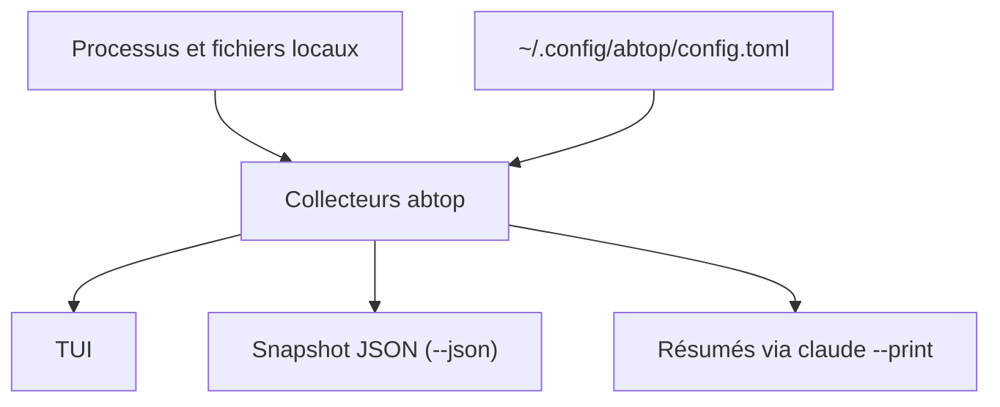

# graykode/abtop

> Terminal dashboard, btop-style, for monitoring your Claude Code, Codex CLI and OpenCode sessions.

## The problem
With several coding agents running in parallel, you lose track of token consumption, quota limits and ports left open.

## What it actually does
Detects Claude Code, Codex CLI and OpenCode sessions from local state (processes and files) and displays them: tokens, context percentage, limits, child processes, open ports. Lets you kill a session or orphaned ports. `--once` and `--json` output for scripts. Everything is read-only, with no API key.

## How it is wired
Simplified diagram based on the fiche, no diagram provided.



## Trying it
```bash
curl --proto '=https' --tlsv1.2 -LsSf https://github.com/graykode/abtop/releases/latest/download/abtop-installer.sh | sh
cargo install abtop
abtop
abtop --once
abtop --json
```

## Cost and gotchas
Free. Session summaries go through `claude --print`, which makes an API call and consumes quota. On Linux and Windows, `sqlite3` is required for OpenCode. The JSON contains sensitive local context.

## What it is not
Not a billing or audit tool: it reads local state and does not query the providers. Token captures depend on the agents' file formats.

## Alternatives
- No alternative named in the README.

## For you
Adopt for a trial: if you run several coding agents, a single screen for quota, context and orphaned ports is useful, read-only and with no account.
