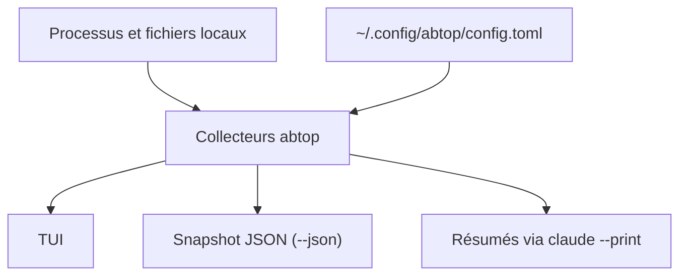

# graykode/abtop

> Tableau de bord terminal, façon btop, pour suivre ses sessions Claude Code, Codex CLI et OpenCode.

## Le problème
Avec plusieurs agents de code en parallèle, on perd de vue la consommation de tokens, les limites de quota et les ports laissés ouverts.

## Ce que ça fait vraiment
Détecte les sessions Claude Code, Codex CLI et OpenCode depuis l'état local (processus et fichiers) et les affiche : tokens, pourcentage de contexte, limites, processus fils, ports ouverts. Permet de tuer une session ou les ports orphelins. Sortie `--once` et `--json` pour scripts. Tout est en lecture seule, sans clé d'API.

## Comment c'est branché
Schéma simplifié d'après la fiche, sans diagramme fourni.



## Essayer
```bash
curl --proto '=https' --tlsv1.2 -LsSf https://github.com/graykode/abtop/releases/latest/download/abtop-installer.sh | sh
cargo install abtop
abtop
abtop --once
abtop --json
```

## Coût et pièges
Gratuit. Les résumés de session passent par `claude --print`, qui fait un appel d'API et consomme du quota. Sous Linux et Windows, `sqlite3` est requis pour OpenCode. Le JSON contient du contexte local sensible.

## Ce que ce n'est pas
Pas un outil de facturation ni d'audit : il lit l'état local et n'interroge pas les fournisseurs. Les captures de tokens dépendent des formats de fichiers des agents.

## Alternatives
- Aucune alternative nommée dans le README.

## Pour toi
À adopter pour essai : si tu lances plusieurs agents de code, un seul écran pour quota, contexte et ports orphelins est utile, lecture seule et sans compte.

