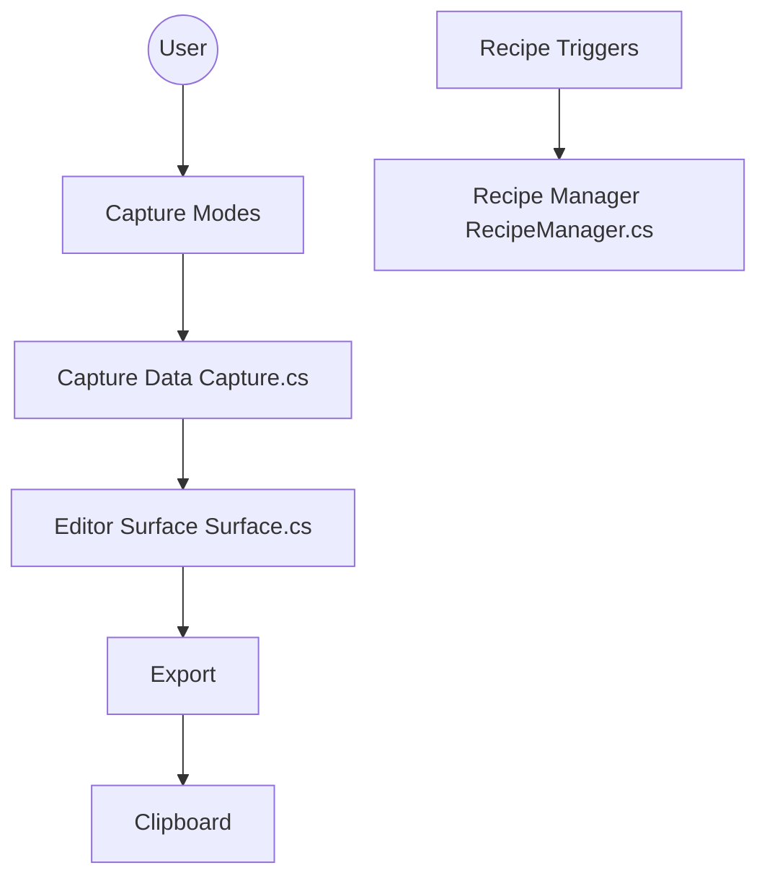

# greenshot/greenshot

> Lightweight Windows screenshot tool with annotation and export to file, clipboard or services.

## The problem
Capturing an area, annotating it and sharing it takes too many steps with the built-in tools.

## What it actually does
Capture of a region, a window or the screen, an annotation editor, highlighting and blurring, then export to file, printer, e-mail, Office or photo sites. This repository is the development branch of 1.4: capture recipes run as a graph, video capture, greenshot-mcp and a browser extension. The Light edition removes plugins and AI tools.

## How it is wired


## Trying it
```powershell
msbuild src\Greenshot.sln /p:Configuration=Debug /t:Build /v:minimal
dotnet test src\Greenshot.Tests\Greenshot.Tests.csproj --configuration Debug
```

## Cost and gotchas
Free, GPL-3.0. Building requires Windows, Visual Studio 2026 and the .NET 10 SDK. The README does not detail end-user installation: it points to the releases. 557 open issues.

## What it is not
It is not the stable version: the documentation in `docs/` describes 1.3. Windows only, not an AI tool.

## Alternatives
No alternative named in the README.

## For you
Ignore for your line of work: a good capture tool, but unrelated to data, AI or MLOps.
