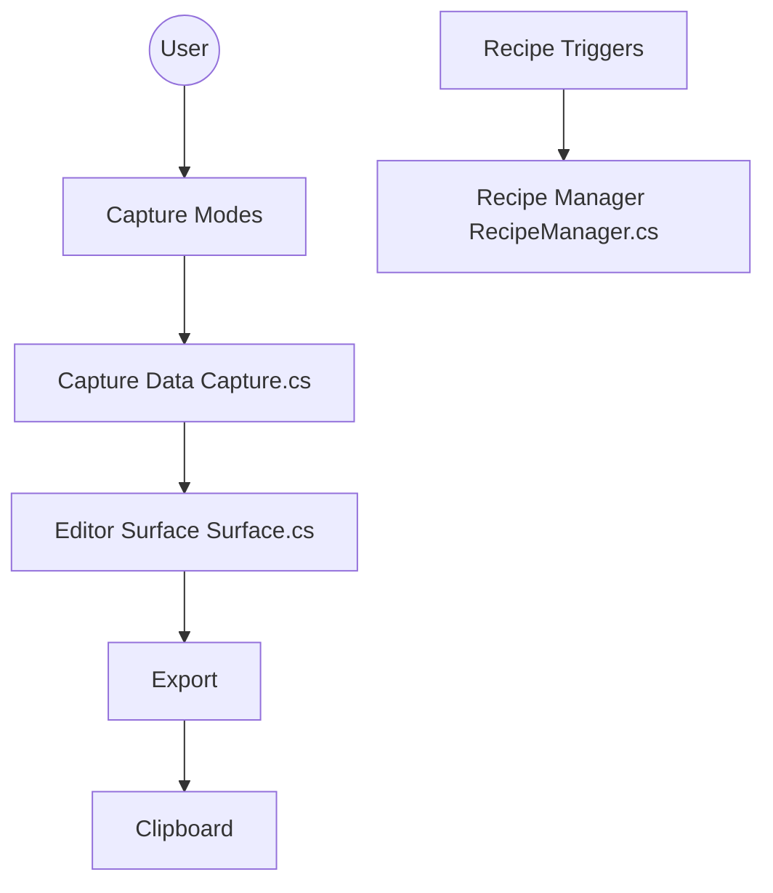

# greenshot/greenshot

> Outil Windows léger de capture d'écran avec annotation et export vers fichier, presse-papiers ou services.

## Le problème
Capturer une zone, l'annoter et la partager prend trop d'étapes avec les outils intégrés.

## Ce que ça fait vraiment
Capture d'une région, d'une fenêtre ou de l'écran, éditeur d'annotations, surlignage et floutage, puis export vers fichier, imprimante, e-mail, Office ou sites de photos. Ce dépôt est la branche de développement de la 1.4 : recettes de capture exécutées comme un graphe, capture vidéo, greenshot-mcp et extension de navigateur. L'édition Light retire plugins et outils IA.

## Comment c'est branché


## Essayer
```powershell
msbuild src\Greenshot.sln /p:Configuration=Debug /t:Build /v:minimal
dotnet test src\Greenshot.Tests\Greenshot.Tests.csproj --configuration Debug
```

## Coût et pièges
Gratuit, GPL-3.0. La compilation exige Windows, Visual Studio 2026 et le SDK .NET 10. Le README ne détaille pas l'installation pour l'utilisateur final : il renvoie aux releases. 557 issues ouvertes.

## Ce que ce n'est pas
Ce n'est pas la version stable : la documentation de `docs/` décrit la 1.3. Windows uniquement, pas un outil d'IA.

## Alternatives
Aucune alternative nommée dans le README.

## Pour toi
À ignorer pour ton métier : bon outil de capture, mais sans lien avec data, IA ou MLOps.

