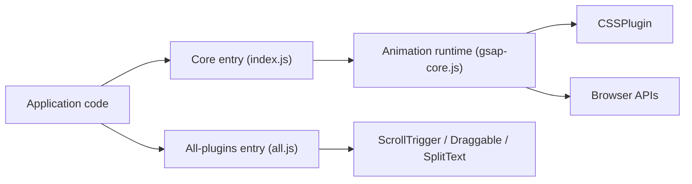

# greensock/GSAP

> Dependency-free JavaScript animation library for front-end developers, from CSS to SVG and canvas.

## The problem
Animating properties over time consistently across browsers, with sequencing and scroll, is laborious by hand.

## What it actually does
The core (`gsap-core.js`) handles tweens, timelines, easings and a ticker that updates the targets' properties; `CSSPlugin` translates values into styles. Separate plugins, registered via `gsap.registerPlugin`, add ScrollTrigger, Draggable, Flip, MorphSVG, SplitText, MotionPath. The README announces that all plugins are now free, even for commercial use.

## How it is wired


## Trying it
```bash
npm install gsap
```
```html
<script src="https://cdn.jsdelivr.net/npm/gsap@3.15/dist/gsap.min.js"></script>
```

## Cost and gotchas
Free according to the README. No license is detected in the catalog: the actual terms of use must be verified before any commercial integration. Register plugins before use.

## What it is not
It is not a React component: the `useGSAP` hook is in a separate package, `@gsap/react`. The repository contains no service or back-end.

## Alternatives
- No alternative named in the README.

## For you
Ignore: web animation tool unrelated to data or AI, and license not declared in the catalog.
