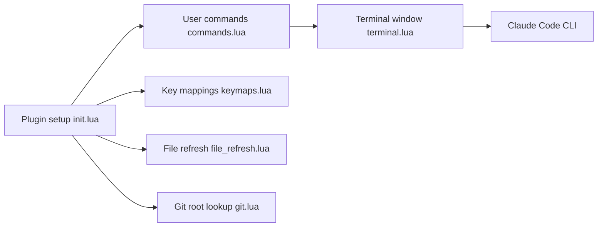

# greggh/claude-code.nvim

> Neovim plugin that opens Claude Code in a terminal and reloads modified files.

## The problem
Using Claude Code and the editor side by side: opening the terminal, finding the git root, refreshing modified buffers.

## What it actually does
A shortcut toggles a Claude Code terminal (split or floating). It moves to the git root, passes variants such as `--continue` or `--resume`, and detects disk changes to reload buffers. which-key integration and 44 tests according to the README.

## How it is wired


## Trying it
```bash
:ClaudeCode
:ClaudeCodeContinue
make test
```

## Cost and gotchas
The Claude Code CLI must be installed, plus plenary.nvim. Claude Code usage remains at your expense. Last push in February 2026, calmer than other plugins of the same kind.

## What it is not
Not a deep integration: it is a terminal that launches the CLI, with file reloading. No edit suggestions or diffs.

## Alternatives
No alternative named in the README.

## For you
Worth watching: enough if you live in Neovim, but a single person maintains it and it stays thin around the CLI.
