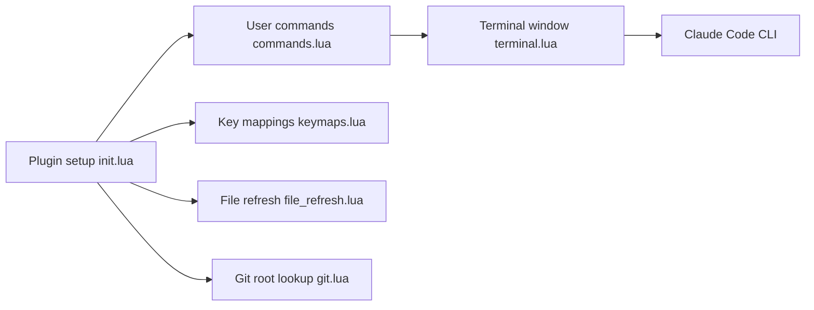

# greggh/claude-code.nvim

> Plugin Neovim qui ouvre Claude Code dans un terminal et recharge les fichiers modifiés.

## Le problème
Utiliser Claude Code et l'éditeur en parallèle : ouvrir le terminal, repérer la racine git, rafraîchir les buffers modifiés.

## Ce que ça fait vraiment
Un raccourci bascule un terminal Claude Code (split ou flottant). Il se place à la racine git, passe des variantes comme `--continue` ou `--resume`, et détecte les changements disque pour recharger les buffers. Intégration which-key et 44 tests selon le README.

## Comment c'est branché


## Essayer
```bash
:ClaudeCode
:ClaudeCodeContinue
make test
```

## Coût et pièges
Il faut le CLI Claude Code installé et plenary.nvim. L'usage de Claude Code reste à ta charge. Dernier push en février 2026, plus calme que d'autres plugins du même type.

## Ce que ce n'est pas
Pas une intégration profonde : c'est un terminal qui lance le CLI, avec rechargement de fichiers. Pas de suggestions d'édition ni de diffs.

## Alternatives
Aucune alternative nommée dans le README.

## Pour toi
Surveiller : suffisant si tu vis sous Neovim, mais une seule personne le maintient et il reste mince autour du CLI.

