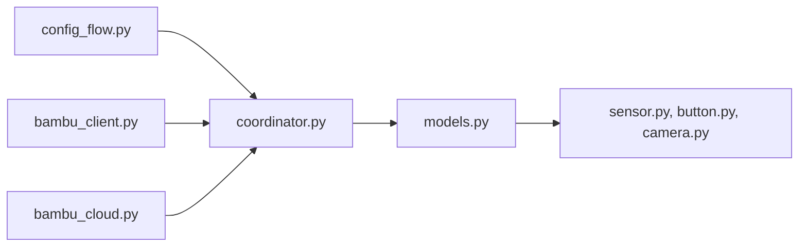

# greghesp/ha-bambulab

> Home Assistant integration to monitor and control Bambu Lab 3D printers.

## The problem
Without an integration, Bambu Lab printers stay outside your Home Assistant home automation.

## What it actually does
Minimal README, everything points to the external documentation. From the code: a config flow, a coordinator that updates a printer model from a local client or the Bambu cloud, and Home Assistant entities (sensors, buttons, switches, camera, updates, diagnostics), plus Lovelace cards.

## How it is wired

## Trying it
No command documented in the README (installation deferred to the docs).

## Cost and gotchas
Free; requires Home Assistant and a Bambu Lab printer. Cloud mode depends on a Bambu account.

## What it is not
Not a standalone tool: without Home Assistant, nothing. The README details neither installation nor configuration.

## Alternatives
No alternative named in the README.

## For you
Ignore: home automation and 3D printing, outside the data/AI/MLOps scope; insufficient README material.
