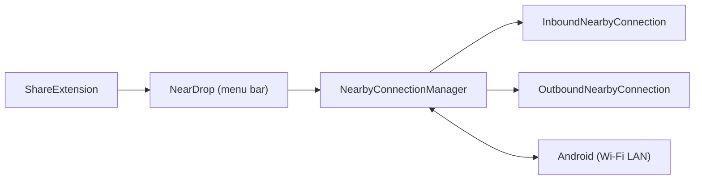

# grishka/NearDrop

> macOS menu bar app that receives and sends files with Android's Quick Share.

## The problem
There is no official Quick Share/Nearby Share client for macOS.

## What it actually does
Partial implementation of Google's protocol: the Mac is visible on the network, the Android device sends via Quick Share, and files are saved to Downloads. Sending is done through the Finder/Safari share extension. Wi-Fi LAN only; Bluetooth and Wi-Fi Direct are not supported, hence a QR code on Android.

## How it is wired


## Trying it
```bash
brew install grishka/grishka/neardrop && sudo xattr -r -d com.apple.quarantine "/Applications/NearDrop.app"
```

## Cost and gotchas
Free, but not notarized: Gatekeeper requires allowing it manually. The device must be on the same local network; visible to everyone on that network while the app is running.

## What it is not
Not an AirDrop for Android, and an incomplete implementation of the protocol.

## Alternatives
None named in the README.

## For you
Worth watching: handy for a Mac and an Android phone, but of no interest for a data/AI workflow.
