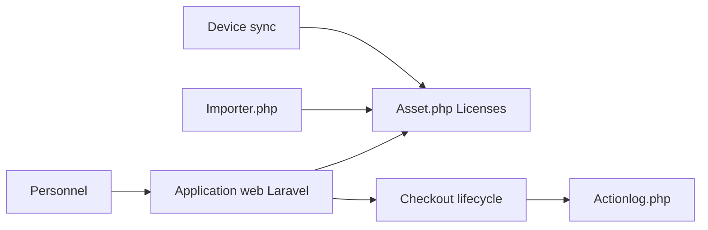

# grokability/snipe-it

> Web-based IT asset management: who holds which equipment, depreciation, software licenses.

## The problem
Track an IT department's hardware, licenses and equipment loans without a spreadsheet.

## What it actually does
Laravel 12 application: inventory (assets, models, components, accessories, consumables, licenses, users), checkout lifecycle with acceptance, activity history, maintenance, reports, REST JSON API, import and synchronization with device management tools (Jamf, Kandji, Mosyle, UniFi through third-party scripts).

## How it is wired

## Trying it
No command documented in the README: it points to the installation manual (Docker image available).

## Cost and gotchas
You need a web server and a database. AGPL-3.0 license: code-sharing obligations if you run a modified version over a network. Mobile apps and modules are third-party, with no guarantee.

## What it is not
Not a desktop application. Not a CMDB or a monitoring tool.

## Alternatives
No alternative named in the README.

## For you
Ignore for data/AI work; relevant only if you manage a hardware fleet.
