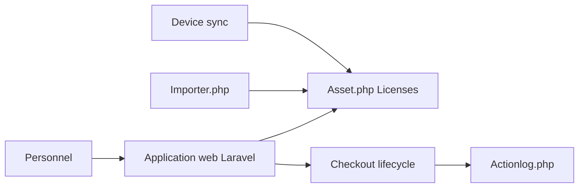

# grokability/snipe-it

> Gestion web de parc informatique : qui détient quel matériel, amortissement, licences logicielles.

## Le problème
Suivre le matériel, les licences et les prêts d'équipement d'une DSI sans tableur.

## Ce que ça fait vraiment
Application Laravel 12 : inventaire (actifs, modèles, composants, accessoires, consommables, licences, utilisateurs), cycle d'affectation avec acceptation, historique d'activité, maintenance, rapports, API JSON REST, import et synchronisation avec des outils de gestion d'appareils (Jamf, Kandji, Mosyle, UniFi par scripts tiers).

## Comment c'est branché

## Essayer
Aucune commande documentée dans le README : il renvoie au manuel d'installation (image Docker disponible).

## Coût et pièges
Il faut un serveur web et une base de données. Licence AGPL-3.0 : obligations de partage du code en cas d'usage réseau modifié. Applications mobiles et modules sont tiers, sans garantie.

## Ce que ce n'est pas
Pas une application de bureau. Pas une CMDB ni un outil de supervision.

## Alternatives
Aucune alternative nommée dans le README.

## Pour toi
Ignorer pour le travail data/IA ; pertinent seulement si tu gères un parc matériel.

