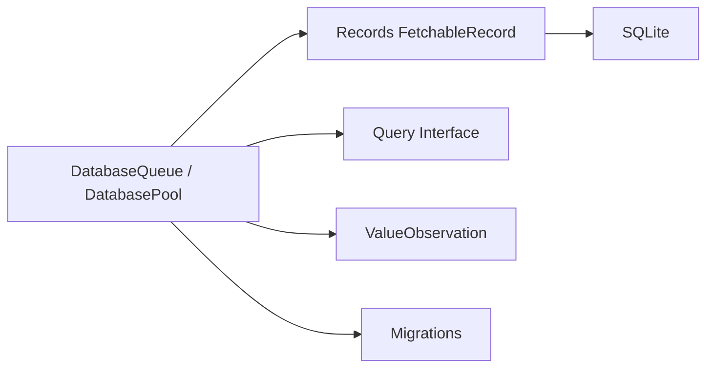

# groue/GRDB.swift

> SQLite toolkit for Swift applications on iOS, macOS, tvOS and watchOS.

## The problem
Storing application data in SQLite in Swift means handling raw SQL, concurrency and migrations.

## What it actually does
SQLite access with connection queues and pools (WAL mode), SQL generation, Codable records, a Swift query interface, migrations, change observation (Combine, RxSwift, async), SQLCipher encryption and backup. Version 7.11.1 cited, Swift 6.1+ required.

## How it is wired


## Trying it
```bash
# Swift Package Manager : ajouter la dépendance
# https://github.com/groue/GRDB.swift.git
```
CocoaPods: `pod 'GRDB.swift'` (limited to version 6.24.1; see the workarounds in the README).

## Cost and gotchas
Free. CocoaPods no longer receives new versions; Carthage is not supported; Linux is not automatically tested.

## What it is not
Not a Core Data-style ORM: records are neither unique, nor automatically updated, nor lazily loaded.

## Alternatives
- FMDB: mentioned as a source of inspiration.

## For you
Ignore: reserved for Apple applications in Swift, of no interest for your data/AI work.
