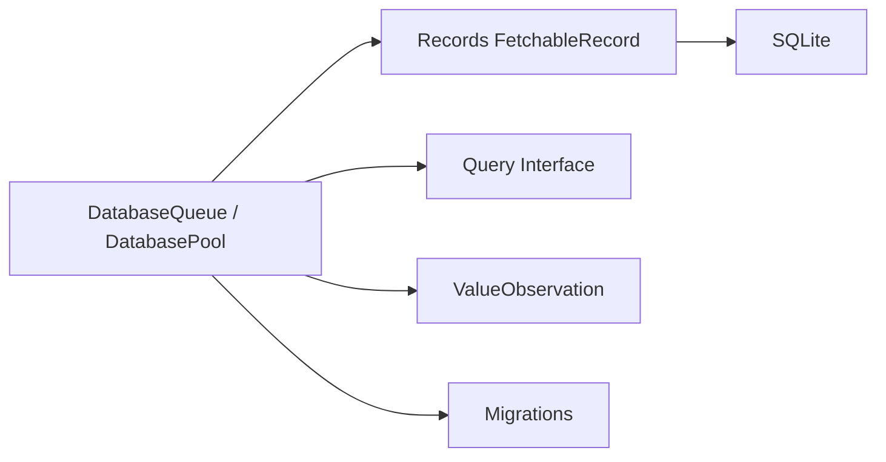

# groue/GRDB.swift

> Boîte à outils SQLite pour applications Swift sur iOS, macOS, tvOS et watchOS.

## Le problème
Stocker des données d'application dans SQLite en Swift oblige à manipuler du SQL brut, de la concurrence et des migrations.

## Ce que ça fait vraiment
Accès SQLite avec files et pools de connexions (mode WAL), génération de SQL, enregistrements Codable, interface de requêtes en Swift, migrations, observation de changements (Combine, RxSwift, async), chiffrement SQLCipher et sauvegarde. Version 7.11.1 citée, Swift 6.1+ requis.

## Comment c'est branché


## Essayer
```bash
# Swift Package Manager : ajouter la dépendance
# https://github.com/groue/GRDB.swift.git
```
CocoaPods : `pod 'GRDB.swift'` (limité à la version 6.24.1 ; voir contournements du README).

## Coût et pièges
Gratuit. CocoaPods ne reçoit plus de nouvelles versions ; Carthage non supporté ; Linux non testé automatiquement.

## Ce que ce n'est pas
Pas un ORM à la Core Data : les enregistrements ne sont ni uniques, ni mis à jour automatiquement, ni chargés paresseusement.

## Alternatives
- FMDB : mentionné comme source d'inspiration.

## Pour toi
À ignorer : réservé aux applications Apple en Swift, sans intérêt pour ton travail data/IA.

