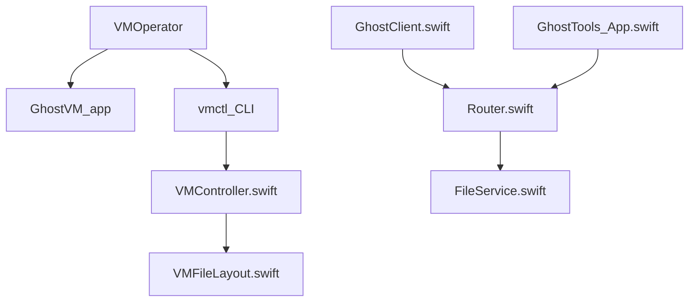

# groundwater/GhostVM

> Native macOS application to create isolated macOS virtual machines, for example to confine AI agents.

## The problem
Running agents or client projects on your machine without isolating them from the rest of the system.

## What it actually does
- Creates macOS VMs via Virtualization.framework; each VM is a copyable `.GhostVM` bundle.
- Snapshots and clones through APFS copy-on-write; VirtioFS shared folders; port forwarding.
- `vmctl` CLI and Unix socket API; GhostTools agent inside the guest (clipboard, files, exec).

## How it is wired


## Trying it
```bash
vmctl init ~/VMs/dev.GhostVM --cpus 6 --memory 16 --disk 128
vmctl install ~/VMs/dev.GhostVM
vmctl start ~/VMs/dev.GhostVM
vmctl snapshot ~/VMs/dev.GhostVM create clean-state
vmctl remote --name dev exec uname -a
```

## Cost and gotchas
Free. Requires macOS 15+ on Apple Silicon; the VM's disk and RAM are on you. Last push on 2026-08-08, so less than a year ago. License missing from the catalog.

## What it is not
Not a Linux or Windows VM; Apple's EULA requires Apple hardware. No declared license: reuse rights are uncertain.

## Alternatives
None named in the README.

## For you
Worth watching: a macOS sandbox for AI agents is relevant, but the missing license blocks serious adoption.
