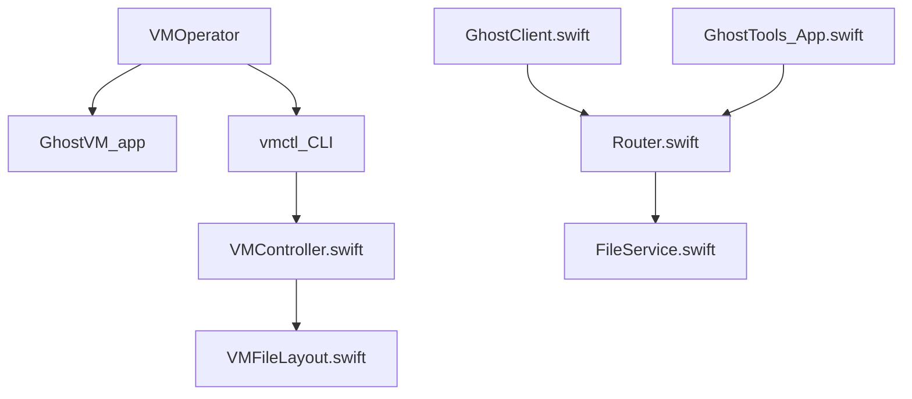

# groundwater/GhostVM

> Application macOS native pour créer des machines virtuelles macOS isolées, par exemple pour cantonner des agents IA.

## Le problème
Faire tourner des agents ou des projets clients sur sa machine sans les isoler du reste du système.

## Ce que ça fait vraiment
- Crée des VM macOS via Virtualization.framework ; chaque VM est un bundle `.GhostVM` copiable.
- Snapshots et clones par copy-on-write APFS ; dossiers partagés VirtioFS ; redirection de ports.
- CLI `vmctl` et API par socket Unix ; agent GhostTools dans l'invité (presse-papiers, fichiers, exec).

## Comment c'est branché


## Essayer
```bash
vmctl init ~/VMs/dev.GhostVM --cpus 6 --memory 16 --disk 128
vmctl install ~/VMs/dev.GhostVM
vmctl start ~/VMs/dev.GhostVM
vmctl snapshot ~/VMs/dev.GhostVM create clean-state
vmctl remote --name dev exec uname -a
```

## Coût et pièges
Gratuit. Exige macOS 15+ sur Apple Silicon ; disque et RAM de la VM à ta charge. Dernier push le 2026-08-08, soit moins d'un an. Licence absente du catalogue.

## Ce que ce n'est pas
Pas une VM Linux ni Windows ; l'EULA d'Apple impose du matériel Apple. Pas de licence déclarée : droits de réutilisation incertains.

## Alternatives
Aucune nommée dans le README.

## Pour toi
À surveiller : un bac à sable macOS pour agents IA est pertinent, mais l'absence de licence bloque une adoption sérieuse.

