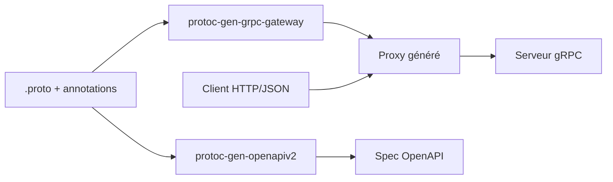

# grpc-ecosystem/grpc-gateway

> protoc plugin that generates a REST/JSON proxy in front of a gRPC service, for teams that expose both.

## The problem
A gRPC service is not easily consumable by clients that expect REST/JSON. Writing and maintaining two APIs by hand is expensive.

## What it actually does
From the `google.api.http` annotations in a `.proto` file, `protoc-gen-grpc-gateway` generates a reverse-proxy server in Go that translates HTTP/JSON into gRPC calls. A second plugin, `protoc-gen-openapiv2`, produces the OpenAPI specification; `protoc-gen-openapiv3` exists but is alpha. The mapping can also come from an external configuration file.

## How it is wired


## Trying it
```bash
go install \
    github.com/grpc-ecosystem/grpc-gateway/v2/protoc-gen-grpc-gateway \
    github.com/grpc-ecosystem/grpc-gateway/v2/protoc-gen-openapiv2 \
    google.golang.org/protobuf/cmd/protoc-gen-go \
    google.golang.org/grpc/cmd/protoc-gen-go-grpc
buf generate
```

## Cost and gotchas
Free. You need protoc or buf and the googleapis files. Keep the same version for the generator and the runtime. Release binaries have SLSA3 signatures.

## What it is not
It is not an API gateway (no authentication or rate limiting provided): only a protocol translator. The OpenAPI 3.1 plugin is not stable.

## Alternatives
The README does not cite any other equivalent project.

## For you
Worth watching: relevant if you serve models or pipelines over gRPC and want a REST facade without duplicate code; useless without gRPC.
