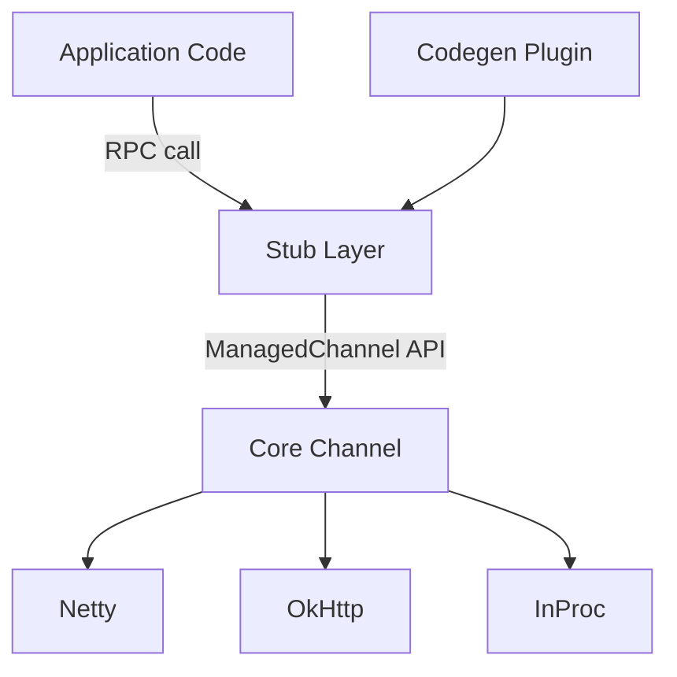

# grpc/grpc-java

> Java and Android RPC library built on HTTP/2 and protobuf, for service developers.

## The problem
Making services talk with typed, efficient contracts requires coding clients, servers and transport yourself.

## What it actually does
Three layers: Stub (code generated from the `.proto` files), Channel (interception, logging, authentication) and Transport (Netty, OkHttp, in-process, Android Binder). Modules cover xDS, ALTS, S2A, load balancing and services (health, reflection, channelz). Java 8 or later is supported.

## How it is wired


## Trying it
```bash
# Dépendances Gradle (README) :
runtimeOnly 'io.grpc:grpc-netty-shaded:1.85.0'
implementation 'io.grpc:grpc-protobuf:1.85.0'
implementation 'io.grpc:grpc-stub:1.85.0'
```

## Cost and gotchas
Free. Java (JDK) and a Maven, Gradle or Bazel build tool are needed; Java is not in the prerequisites list. The `@Internal` and `@ExperimentalApi` APIs are not stable.

## What it is not
Not a ready-to-use server: it is a library to integrate into a Java application.

## Alternatives
No alternative named in the README.

## For you
Ignore for your profile: it is the Java building block of gRPC, useful only if you build Java services; in Python you will use another implementation.
