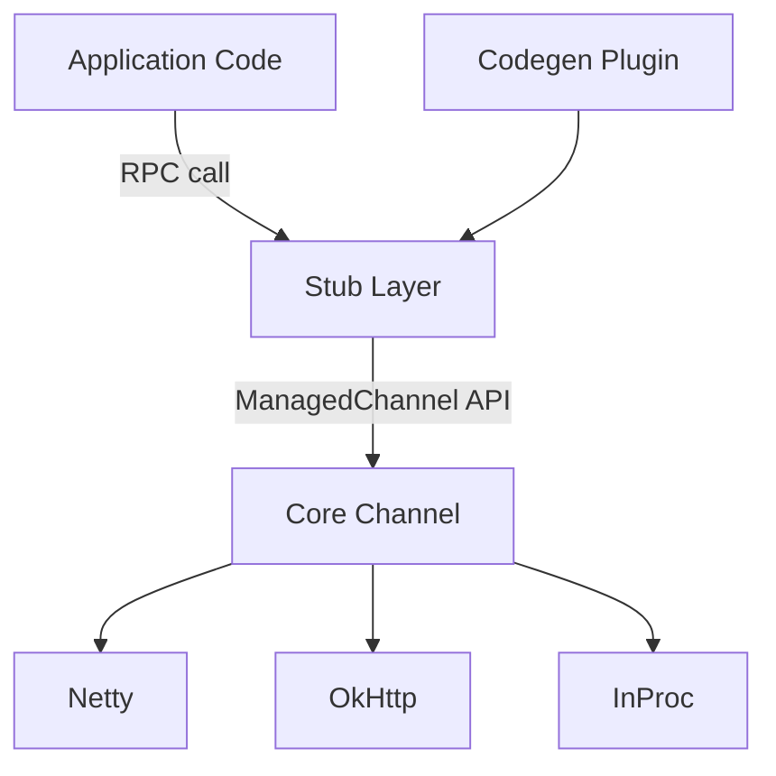

# grpc/grpc-java

> Bibliothèque RPC Java et Android reposant sur HTTP/2 et protobuf, pour développeurs de services.

## Le problème
Faire dialoguer des services avec des contrats typés et efficaces demande de coder soi-même clients, serveurs et transport.

## Ce que ça fait vraiment
Trois couches : Stub (code généré depuis les `.proto`), Channel (interception, journalisation, authentification) et Transport (Netty, OkHttp, in-process, Binder Android). Des modules couvrent xDS, ALTS, S2A, équilibrage de charge et services (health, reflection, channelz). Java 8 ou plus est supporté.

## Comment c'est branché


## Essayer
```bash
# Dépendances Gradle (README) :
runtimeOnly 'io.grpc:grpc-netty-shaded:1.85.0'
implementation 'io.grpc:grpc-protobuf:1.85.0'
implementation 'io.grpc:grpc-stub:1.85.0'
```

## Coût et pièges
Gratuit. Java (JDK) et un outil de build Maven, Gradle ou Bazel sont nécessaires ; Java ne figure pas dans la liste de prérequis. Les API `@Internal` et `@ExperimentalApi` ne sont pas stables.

## Ce que ce n'est pas
Pas un serveur prêt à l'emploi : c'est une bibliothèque à intégrer dans une application Java.

## Alternatives
Aucune alternative nommée dans le README.

## Pour toi
À ignorer pour ton profil : c'est la brique Java de gRPC, utile seulement si tu fais des services Java ; en Python tu utiliseras une autre implémentation.

