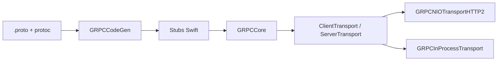

# grpc/grpc-swift-2

> gRPC implementation for Swift, version 2, to be composed with a transport and SwiftProtobuf.

## The problem
Calling or exposing gRPC services from Swift requires a runtime, a stub generator and a transport.

## What it actually does
Provides `GRPCCore` (client and server calls, interceptors, streaming, compression, method configs), a code generation plugin from `.proto` files, an in-memory transport (`GRPCInProcessTransport`) for tests and the `grpc-dev-tool` tool. The HTTP/2 transport and the Protobuf integration live in separate repositories.

## How it is wired


## Trying it
```bash
# Package.swift (swift-tools-version: 6.1, macOS 15)
.package(url: "https://github.com/grpc/grpc-swift-2.git", from: "2.0.0"),
.package(url: "https://github.com/grpc/grpc-swift-nio-transport.git", from: "2.0.0"),
.package(url: "https://github.com/grpc/grpc-swift-protobuf.git", from: "2.0.0"),
```

## Cost and gotchas
Free. Swift 6.1 and macOS 15 required in the example; three packages to combine.

## What it is not
Not a standalone package: without the NIO transport and SwiftProtobuf, nothing travels over the network.

## Alternatives
- grpc-swift-nio-transport: required HTTP/2 transport.
- grpc-swift-protobuf: Protobuf integration.
- grpc-swift-extras: optional add-ons.

## For you
Ignore: reserved for Swift developers; for model- or service-side gRPC, the project's `grpc/grpc` repository is more relevant.
