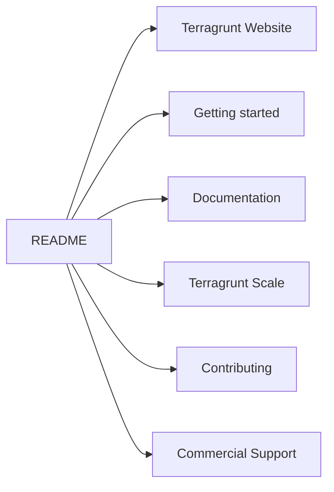

# gruntwork-io/terragrunt

> Orchestrator for scaling infrastructure written in OpenTofu or Terraform.

## The problem
Not detailed in this README: it only states that infrastructure as code written in
OpenTofu/Terraform needs a tool to scale.

## What it actually does
The README does not describe how it works. It presents itself as a flexible orchestration tool
that lets OpenTofu/Terraform IaC scale, and points to six external resources:
the project website, a getting-started guide, the documentation, a "Terragrunt Scale" page, the
contribution guide and a commercial support offer. No feature, command or architecture
is documented here.

## How it is wired

## Trying it
No command documented in this README; installation is deferred to the project website.

## Cost and gotchas
Not documented here. The only clue: a **commercial support** offer is available, which suggests an
open model backed by paid services.

## What it is not
This README does not allow saying: no scope, no limits, no license, no prerequisites.
It does not replace OpenTofu/Terraform, which it orchestrates — that is the only limit deducible from the text.
Very insufficient material to decide.

## Alternatives
No alternative repository is named in the README.

## For you
A well-known tool on the infra side, but nothing in this README allows evaluating it: go through the project website.
