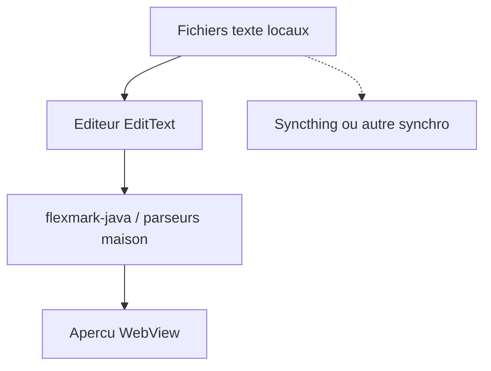

# gsantner/markor

> Android text editor for Markdown notes and todo.txt lists, working offline.

## The problem
Taking notes and managing tasks on a phone in open text files, without a proprietary app or an account.

## What it actually does
Java editor on Android with custom syntax highlighting, WebView preview and the flexmark-java Markdown parser. It handles Markdown, todo.txt, Zim Wiki, AsciiDoc, CSV and Org-Mode. Files stay local in a folder you choose; synchronization goes through third-party apps such as Syncthing.

## How it is wired

Simplified diagram based on the sheet, no diagram provided.

## Trying it
```bash
make all install run
```

## Cost and gotchas
Free, installed through F-Droid or GitHub. The README states a license is present but not identified by GitHub: check before any reuse. The build assumes Android Studio.

## What it is not
It is not a synchronization solution: the app stays offline and delegates sync to other tools. Android only.

## Alternatives
No alternative is cited in the README.

## For you
Ignore for your line of work: a good Android note editor, but unrelated to data, AI or MLOps.
