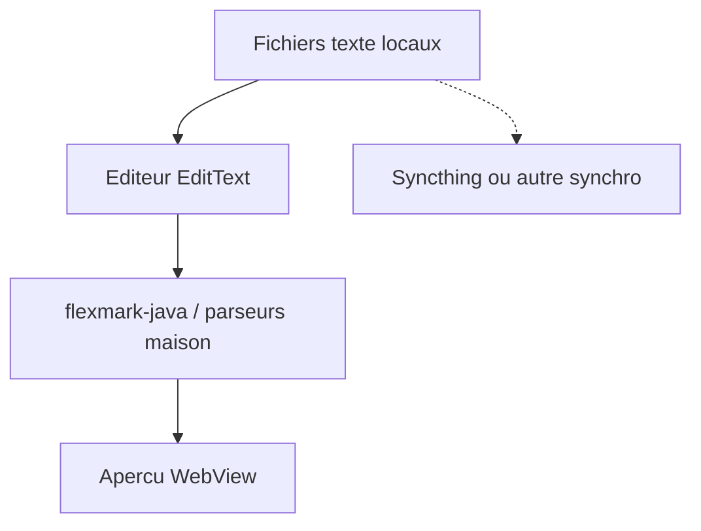

# gsantner/markor

> Éditeur de texte Android pour notes Markdown et listes todo.txt, fonctionnant hors ligne.

## Le problème
Prendre des notes et gérer ses tâches sur téléphone dans des fichiers texte ouverts, sans application propriétaire ni compte.

## Ce que ça fait vraiment
Éditeur Java sur Android avec coloration syntaxique maison, aperçu par WebView et analyseur Markdown flexmark-java. Il gère Markdown, todo.txt, Zim Wiki, AsciiDoc, CSV et Org-Mode. Les fichiers restent en local dans un dossier choisi ; la synchronisation passe par des applications tierces comme Syncthing.

## Comment c'est branché

Schéma simplifié d'après la fiche, sans diagramme fourni.

## Essayer
```bash
make all install run
```

## Coût et pièges
Gratuit, installation par F-Droid ou GitHub. Le README annonce une licence présente mais non identifiée par GitHub : à vérifier avant tout réemploi. Le build suppose Android Studio.

## Ce que ce n'est pas
Ce n'est pas une solution de synchronisation : l'application reste hors ligne et délègue le sync à d'autres outils. Android uniquement.

## Alternatives
Aucune alternative n'est citée dans le README.

## Pour toi
À ignorer pour ton métier : un bon éditeur de notes Android, mais sans lien avec la data, l'IA ou le MLOps.

