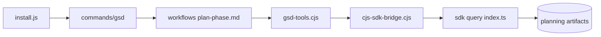

# gsd-build/get-shit-done

> Former GSD repository, a file-based system for planning and executing code for agents.

## The problem
Not documented in the README, which only provides a redirection.

## What it actually does
The README only states that the project has moved to GSD Core. According to the provided architecture: slash commands (`commands/gsd/`) direct to Markdown workflows (plan-phase, execute-phase, verify-work), supported by a Node CLI (`gsd-tools.cjs`) and a TypeScript SDK that reads and modifies a local planning space (roadmap, phases, decisions). The installer (`install.js`) sets up commands, hooks, and agents for Claude, Codex, Gemini, and OpenCode.

## How it is wired

## Trying it
No documented commands are found in the README file.

## Cost and gotchas
Nothing is specified in the README. The repository is archived.

## What it is not
This is not the active version: the latest sources, outputs, and versions can be found elsewhere.

## Alternatives
- open-gsd/gsd-core — the project's successor, as specified in the README.

## For you
Ignore this; if the concept interests you, please see open-gsd/gsd-core.
