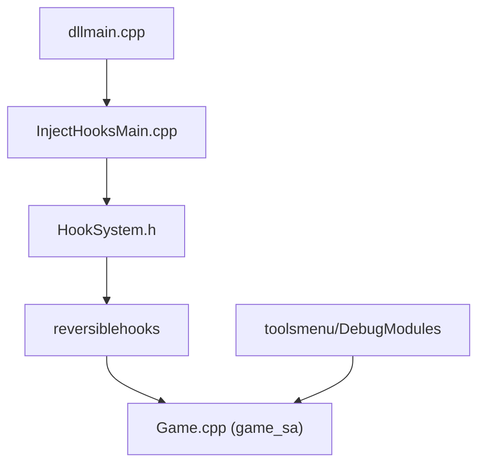

# gta-reversed/gta-reversed

> Documented C++ rewrite of GTA San Andreas functions, injected as a DLL into the game.

## The problem
The GTA San Andreas source code is not public; understanding or modifying it means reverse engineering.

## What it actually does
The build produces a DLL loaded by an ASI loader: a hook layer redirects the original functions to the rewritten versions (entities, scripts, rendering, audio, platform), with a debug tools menu. The README estimates 50 to 60% of the code is done, with no timeline. You must own the game, with the exact Compact executable.

## How it is wired


## Trying it
```bash
python setup.py
python setup.py --build
# puis contrib/install.py en administrateur
```

## Cost and gotchas
Free, but Windows, Visual Studio 2026, Conan and CMake are required. You need a copy of the game. No license declared: usage and reuse rights are unclear. 193 open issues.

## What it is not
Not a standalone executable: it depends on the original game installation and a specific exe.

## Alternatives
The README mentions re3 and plugin-sdk, whose work it builds on.

## For you
Ignore: game reverse engineering unrelated to your field, and no license.
