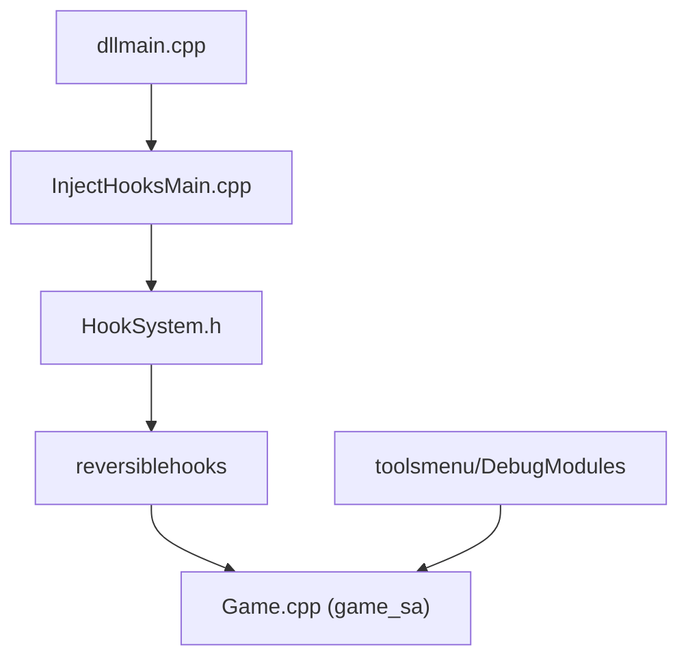

# gta-reversed/gta-reversed

> Réécriture en C++ documentée des fonctions de GTA San Andreas, injectée comme DLL dans le jeu.

## Le problème
Le code source de GTA San Andreas n'est pas public ; le comprendre ou le modifier passe par la rétro-ingénierie.

## Ce que ça fait vraiment
La compilation produit une DLL chargée par un ASI loader : une couche de hooks redirige les fonctions d'origine vers les versions réécrites (entités, scripts, rendu, audio, plateforme), avec un menu d'outils de débogage. Le README estime 50 à 60 % du code fait, sans calendrier. Il faut posséder le jeu, exécutable Compact exact.

## Comment c'est branché


## Essayer
```bash
python setup.py
python setup.py --build
# puis contrib/install.py en administrateur
```

## Coût et pièges
Gratuit, mais Windows, Visual Studio 2026, Conan et CMake sont requis. Il faut un exemplaire du jeu. Aucune licence déclarée : droits d'usage et de réutilisation flous. 193 issues ouvertes.

## Ce que ce n'est pas
Pas un exécutable autonome : il dépend de l'installation d'origine du jeu et d'un exe précis.

## Alternatives
Le README mentionne re3 et plugin-sdk, dont il reprend le travail.

## Pour toi
À ignorer : rétro-ingénierie de jeu sans rapport avec ton métier, et licence absente.

