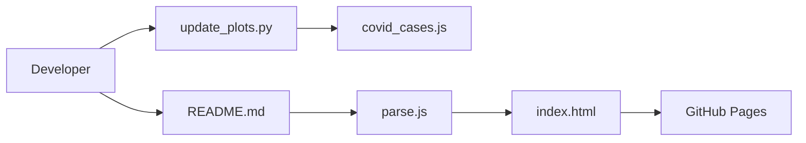

# gto76/python-cheatsheet

> Very dense Python cheat sheet, from basic syntax to NumPy, Pandas and Plotly.

## The problem
Quickly find the right syntax or the right library without rereading several documentations.

## What it actually does
The README is the sheet itself: collections, types, syntax, files, formats (JSON, CSV, SQLite), threads, asyncio, then packages (NumPy, Pandas, Plotly, Pygame, Flask). Each code block is commented line by line. A web page (`index.html` + `parse.js`) reads the `README.md` in the browser; Python scripts produce the data for the charts.

## How it is wired


## Trying it
```bash
# Aucune installation : lire le README ou la page web.
# Les exemples demandent leurs paquets, par exemple :
# pip3 install numpy
# pip3 install pandas matplotlib
# pip3 install plotly kaleido pandas
```

## Cost and gotchas
Free. Some examples (Selenium, Yahoo Finance scraping, remote Covid dataset) depend on external sites that may change.

## What it is not
Not a course: it assumes you already know the concepts. The catalog indicates no license: reuse of the text is not framed.

## Alternatives
No alternative named in the README.

## For you
Adopt it as a desk reference for a data profile: the NumPy, Pandas and Plotly sections are directly useful; just check the license before copying content.
