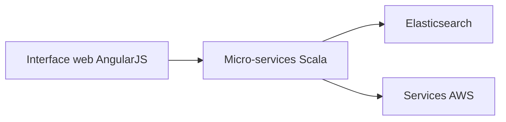

# guardian/grid

> The Guardian's image management system, for newsrooms that want to find and reuse their media.

## The problem
Quickly finding and reusing a newsroom's images from a growing corpus.

## What it actually does
- Independent microservices in Scala and Play Framework, exposed as a hypermedia API (argo).
- Web interface in AngularJS.
- Search on Elasticsearch, storage and messaging on AWS services.
- Installation guide in the external documentation.

## How it is wired

## Trying it
No command documented in the README.

## Cost and gotchas
Depends on AWS and Elasticsearch: infrastructure costs are on you. AngularJS is old.

## What it is not
Not a turnkey tool: the README gives no installation steps.

## Alternatives
No alternative named in the README.

## For you
Ignore: a newsroom's media asset management, with a heavy stack unrelated to data / AI.
