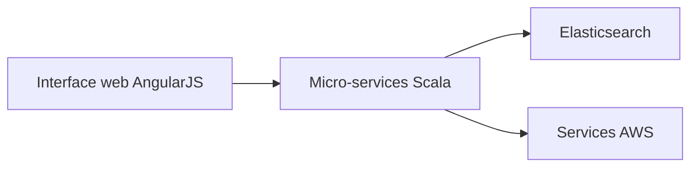

# guardian/grid

> Système de gestion d'images du Guardian, pour rédactions qui veulent retrouver et réutiliser leurs médias.

## Le problème
Retrouver et réutiliser rapidement les images d'une rédaction à partir d'un corpus qui grandit.

## Ce que ça fait vraiment
- Micro-services indépendants en Scala et Play Framework, exposés en API hypermédia (argo).
- Interface web en AngularJS.
- Recherche sur Elasticsearch, stockage et messagerie sur des services AWS.
- Guide d'installation dans la documentation externe.

## Comment c'est branché

## Essayer
Aucune commande documentée dans le README.

## Coût et pièges
Dépend d'AWS et d'Elasticsearch : coûts d'infrastructure à ta charge. AngularJS est ancien.

## Ce que ce n'est pas
Pas un outil clé en main : le README ne donne aucune installation.

## Alternatives
Aucune alternative nommée dans le README.

## Pour toi
À ignorer : gestion d'actifs médias d'une rédaction, avec une pile lourde sans lien avec data / IA.

