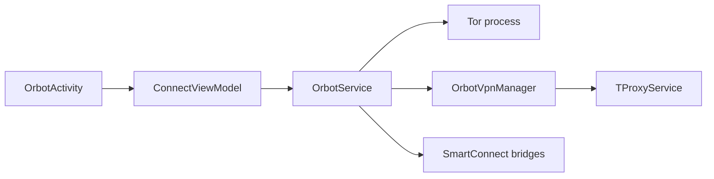

# guardianproject/orbot-android

> Android application that routes other apps' traffic through Tor, for activists, journalists and privacy-conscious users.

## The problem
Mobile traffic reveals your IP address and lends itself to traffic analysis; on censored networks, Tor is often blocked.

## What it actually does
Orbot runs Tor in a separate Android process (`:tor`) and acts as a VPN/proxy for the chosen apps (`TorifiedApp`). It handles bridges (bridges, Moat, Snowflake) against censorship, hosting of v3 onion services, and a "Kindness" mode that runs a Snowflake proxy to help others.

## How it is wired


## Trying it
```bash
git clone --recursive https://github.com/guardianproject/orbot-android
cd orbot-android
./gradlew assembleFullpermDebug
```

## Cost and gotchas
Free. Building requires the `hev-socks5-tunnel` submodule (native C code). License flagged as unidentified by GitHub.

## What it is not
Not a guarantee of anonymity: the README itself says to read the instructions and configure correctly. Not a reusable library.

## Alternatives
- None cited in the README.

## For you
Ignore for data/AI work: it is a consumer app unrelated to your field, unless you personally need Tor on Android.
