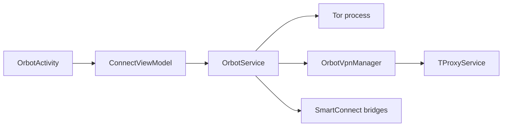

# guardianproject/orbot-android

> Application Android qui fait passer le trafic d'autres applications par Tor, pour activistes, journalistes et usagers soucieux de vie privée.

## Le problème
Le trafic mobile révèle votre adresse IP et se prête à l'analyse de trafic ; en réseau censuré, Tor est souvent bloqué.

## Ce que ça fait vraiment
Orbot lance Tor dans un processus Android séparé (`:tor`) et agit comme VPN/proxy pour les applications choisies (`TorifiedApp`). Il gère des ponts (bridges, Moat, Snowflake) contre la censure, l'hébergement de services onion v3 et un mode « Kindness » qui fait tourner un proxy Snowflake pour aider les autres.

## Comment c'est branché


## Essayer
```bash
git clone --recursive https://github.com/guardianproject/orbot-android
cd orbot-android
./gradlew assembleFullpermDebug
```

## Coût et pièges
Gratuit. La compilation exige le sous-module `hev-socks5-tunnel` (code natif C). Licence signalée comme non identifiée par GitHub.

## Ce que ce n'est pas
Pas une garantie d'anonymat : le README dit lui-même de lire les instructions et de configurer correctement. Pas une bibliothèque réutilisable.

## Alternatives
- Aucune citée dans le README.

## Pour toi
À ignorer pour un travail data/IA : c'est une app grand public sans lien avec ton métier, sauf besoin personnel de Tor sur Android.

