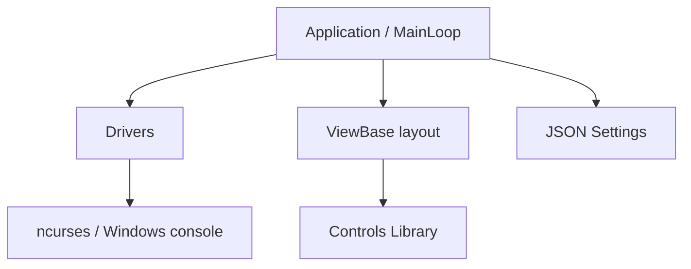

# gui-cs/Terminal.Gui

> Cross-platform .NET toolkit for rich terminal interfaces, for CLI tool developers.

## The problem
.NET console applications have neither responsive layout nor serious widgets.

## What it actually does
A layered library: drivers (Curses, Windows, Net, Ansi, Fake for tests), main loop, drawing, keyboard/mouse input, views with Pos/Dim layout, widgets (tables, trees, editors, file pickers, graphs). Full-screen or inline mode; Roslyn analyzers included.

## How it is wired


## Trying it
```bash
dotnet new install Terminal.Gui.Templates
dotnet new tui-simple -n myproj
cd myproj
dotnet run
dotnet add package Terminal.Gui
```

## Cost and gotchas
Free; .NET required. v1 to v2 migration documented (API changes).

## What it is not
Not an application: a library. Tied to .NET, not Python.

## Alternatives
No alternative named.

## For you
Watch: only if you write CLI tools in C#. Otherwise irrelevant for data/AI.
