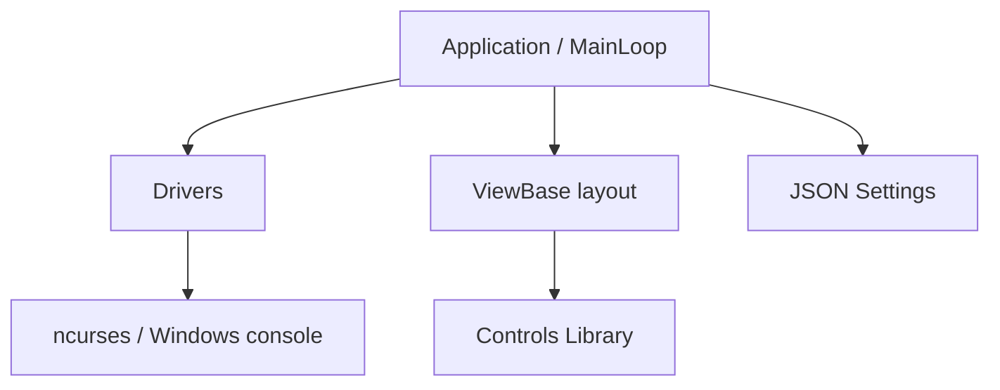

# gui-cs/Terminal.Gui

> Boîte à outils .NET multiplateforme pour interfaces terminal riches, pour développeurs d'outils CLI.

## Le problème
Les applications console .NET n'ont ni mise en page réactive ni widgets sérieux.

## Ce que ça fait vraiment
Bibliothèque en couches : pilotes (Curses, Windows, Net, Ansi, Fake pour les tests), boucle principale, dessin, saisie clavier/souris, vues avec layout Pos/Dim, widgets (tables, arbres, éditeurs, sélecteurs de fichiers, graphes). Mode plein écran ou en ligne ; analyseurs Roslyn inclus.

## Comment c'est branché


## Essayer
```bash
dotnet new install Terminal.Gui.Templates
dotnet new tui-simple -n myproj
cd myproj
dotnet run
dotnet add package Terminal.Gui
```

## Coût et pièges
Gratuit ; .NET requis. Migration v1 vers v2 documentée (changements d'API).

## Ce que ce n'est pas
Pas une application : une bibliothèque. Lié à .NET, pas à Python.

## Alternatives
Aucune alternative nommée.

## Pour toi
Surveiller : seulement si tu écris des outils CLI en C#. Sinon sans objet pour data/IA.

