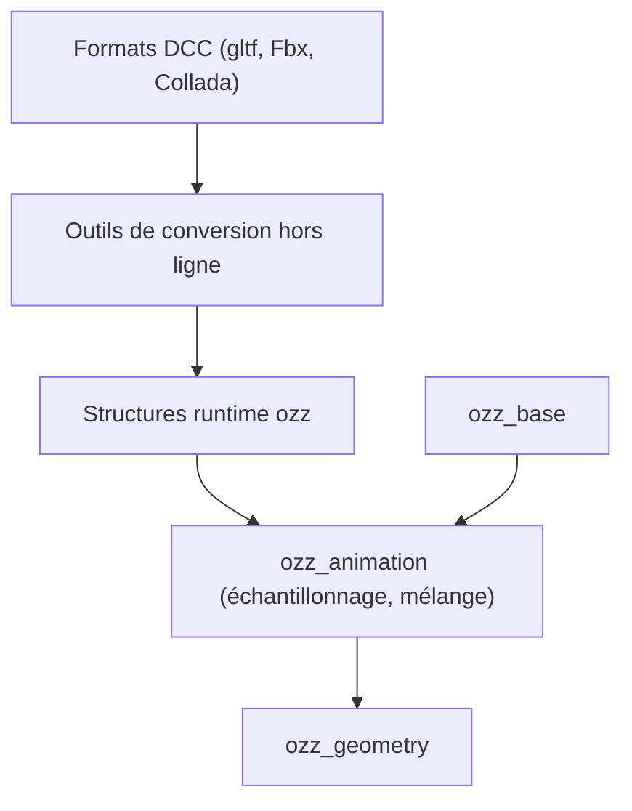

# guillaumeblanc/ozz-animation

> C++ 3D skeletal animation library and toolchain, agnostic of the game engine and the renderer.

## The problem
Reading, sampling and blending character animations in real time requires compact, fast code that is independent of the engine.

## What it actually does
Provides runtime loading, sampling and blending of animations, with a data-oriented, memory-conscious design. A toolchain converts from gltf, Fbx, Collada, Obj, 3ds and dxf into optimized runtime structures. The runtime depends only on C++17 and the standard library; the samples and tools use glfw, tinygltf, Fbx SDK and gtest.

## How it is wired
Simplified diagram based on the sheet, no diagram provided.

## Trying it
No command documented in the README: documentation and samples are on the project's website.

## Cost and gotchas
Free. A license is present but not identified by GitHub (the README states MIT). The samples and tests require external libraries.

## What it is not
Not a game engine nor a rendering engine. Not a motion capture tool.

## Alternatives
No alternative cited in the README.

## For you
Ignore: 3D game animation, unrelated to data or AI.
