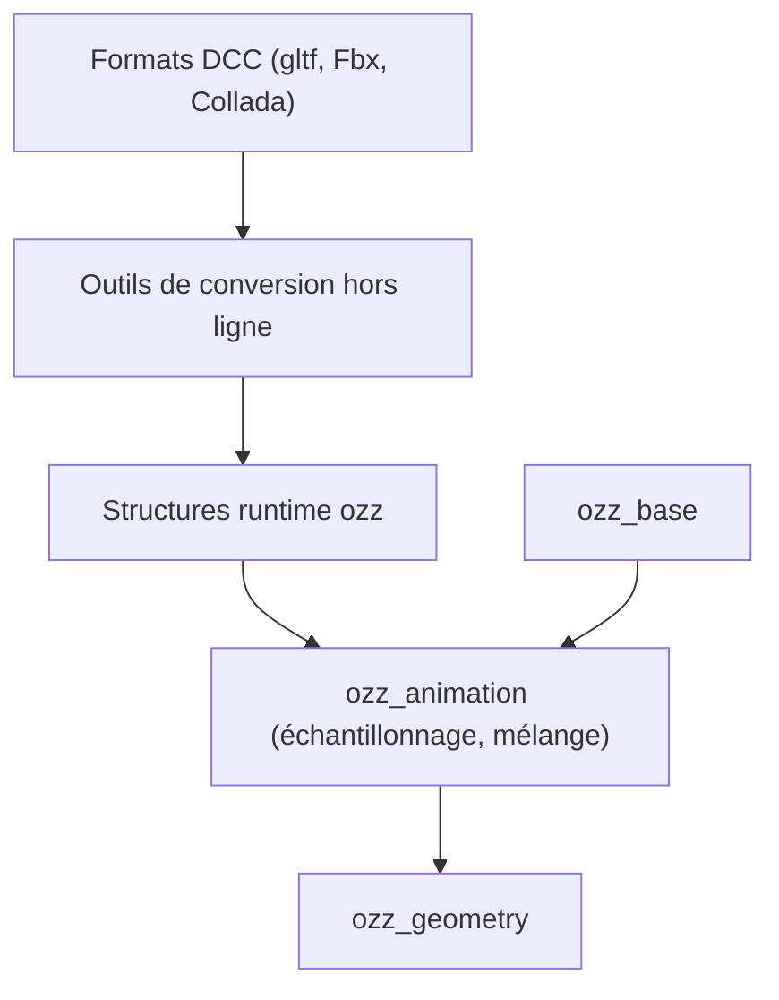

# guillaumeblanc/ozz-animation

> Bibliothèque C++ d'animation squelettique 3D et chaîne d'outils, agnostique du moteur de jeu et du rendu.

## Le problème
Lire, échantillonner et mélanger des animations de personnages en temps réel exige un code compact et rapide, indépendant du moteur.

## Ce que ça fait vraiment
Fournit au runtime le chargement, l'échantillonnage et le mélange d'animations, avec une conception orientée données soucieuse de la mémoire. Une chaîne d'outils convertit depuis gltf, Fbx, Collada, Obj, 3ds et dxf vers des structures runtime optimisées. Le runtime ne dépend que de C++17 et de la bibliothèque standard ; les exemples et outils utilisent glfw, tinygltf, Fbx SDK et gtest.

## Comment c'est branché
Schéma simplifié d'après la fiche, sans diagramme fourni.

## Essayer
Aucune commande documentée dans le README : la documentation et les exemples sont sur le site du projet.

## Coût et pièges
Gratuit. Licence présente mais non identifiée par GitHub (le README annonce MIT). Les exemples et tests demandent des bibliothèques externes.

## Ce que ce n'est pas
Pas un moteur de jeu ni un moteur de rendu. Pas un outil de capture de mouvement.

## Alternatives
Aucune alternative citée dans le README.

## Pour toi
Ignorer : animation 3D de jeu, sans lien avec la data ou l'IA.

