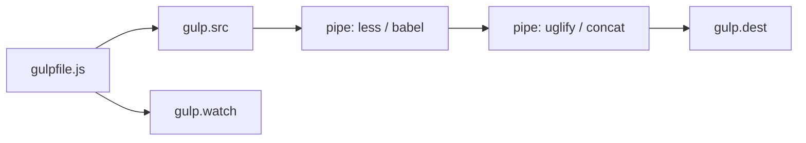

# gulpjs/gulp

> Node.js task automator based on file streams, for web developers who script their build.

## The problem
Manually chaining style compilation, minification and file copying on every change.

## What it actually does
A `gulpfile.js` (or `.mjs`) declares tasks as functions returning a promise, a stream, or calling a callback. `gulp.src` reads files by glob, `.pipe()` passes them to plugins (less, babel, uglify, concat…), `gulp.dest` writes the result. `series` and `parallel` compose tasks; `watch` reruns on change; `lastRun` reprocesses only changed files.

## How it is wired


## Trying it
```bash
# Le README renvoie au Quick Start du site ; l'extrait de code fourni :
gulp   # lance la tâche par défaut (exports.default = build)
```

## Cost and gotchas
Free. Each transformation requires an npm plugin. The README warns that the documentation is being updated ("excuse our dust").

## What it is not
Not a module bundler. Not a data tool. Tasks are Node code to maintain.

## Alternatives
None cited in the README.

## For you
Ignore: front-end build tool; your data/AI/MLOps work goes through other toolchains (Make, CI, pipelines).
