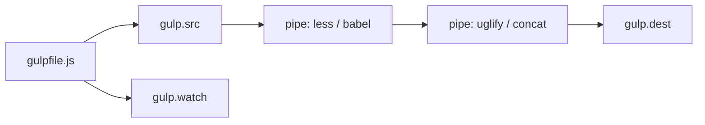

# gulpjs/gulp

> Automatiseur de tâches Node.js par flux de fichiers, pour les développeurs web qui scriptent leur build.

## Le problème
Enchaîner à la main compilation de styles, minification et copie de fichiers à chaque modification.

## Ce que ça fait vraiment
Un `gulpfile.js` (ou `.mjs`) déclare des tâches comme fonctions retournant une promesse, un flux ou appelant un callback. `gulp.src` lit des fichiers par glob, `.pipe()` les passe à des plugins (less, babel, uglify, concat…), `gulp.dest` écrit le résultat. `series` et `parallel` composent les tâches ; `watch` relance à la modification ; `lastRun` ne retraite que les fichiers changés.

## Comment c'est branché


## Essayer
```bash
# Le README renvoie au Quick Start du site ; l'extrait de code fourni :
gulp   # lance la tâche par défaut (exports.default = build)
```

## Coût et pièges
Gratuit. Chaque transformation exige un plugin npm. Le README prévient que la documentation est en cours de mise à jour (« excuse our dust »).

## Ce que ce n'est pas
Pas un bundler de modules. Pas un outil de données. Les tâches sont du code Node à maintenir.

## Alternatives
Aucune citée dans le README.

## Pour toi
Ignorer : outil de build front-end ; ton travail data/IA/MLOps passe par d'autres chaînes (Make, CI, pipelines).

