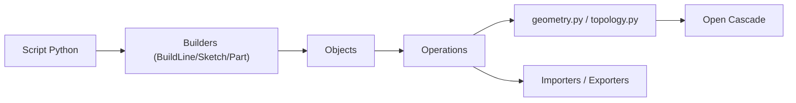

# gumyr/build123d

> Python framework for parametric 2D and 3D CAD modeling, based on Open Cascade.

## The problem
Drawing parts for 3D printing or machining with a mouse is hard to version and hard to parameterize.

## What it actually does
You write the geometry in Python, in algebra mode (`part += ...`) or in Builder mode with `BuildLine`, `BuildSketch`, `BuildPart` contexts. Selectors filter edges and faces, and objects can be subclassed. Import and export cover STEP, STL and SVG. The project is derived from CadQuery.

## How it is wired


## Trying it
```bash
pip install build123d
pip install --upgrade pip
pip install git+https://github.com/gumyr/build123d
```

## Cost and gotchas
Free. A viewer such as ocp_vscode is recommended. About 328 open issues.

## What it is not
Not a graphical CAD application. Not a simulation tool.

## Alternatives
- CadQuery: the project build123d is derived from, before its redesign.

## For you
Worth watching if you generate parts by code or 3D datasets: a good "CAD-as-code" approach, outside the core data/AI field.
