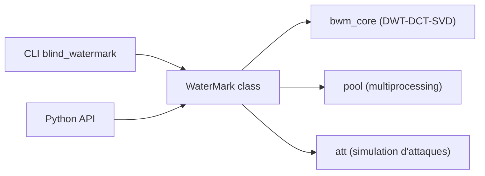

# guofei9987/blind_watermark

> Python library that hides text or an image inside an image using DWT-DCT-SVD, without needing the original to extract it.

## The problem
Marking an image invisibly to prove its provenance, with a watermark that survives edits.

## What it actually does
The `WaterMark` class reads an image and a watermark (text, image or bit array), blends them through DWT-DCT-SVD transforms (`bwm_core.py`) with two passwords, then extracts the watermark from a marked image. The README shows a successful extraction after rotation, random cropping, masks, resizing, noise or brightness reduction. Parallel processing is available (`processes`).

## How it is wired


## Trying it
```bash
pip install blind-watermark
blind_watermark --embed --pwd 1234 examples/pic/ori_img.jpeg "watermark text" examples/output/embedded.png
blind_watermark --extract --pwd 1234 --wm_shape 111 examples/output/embedded.png
```

## Cost and gotchas
Free. The watermark shape (`wm_shape`) must be known at extraction. For bits, the output is an array of floats to threshold (for example 0.5). No robustness figure beyond the README's visual examples.

## What it is not
Not a legally proven copyright protection system, and not a watermark for generative model outputs: it works on images that are already produced.

## Alternatives
The README cites `text_blind_watermark` (message in text) and `HideInfo` (hide in image, sound or text), by the same author.

## For you
Watch: useful for watermarking image sets or outputs, but maintained by a single person and with no quantified evaluation of its robustness; test before relying on it.
