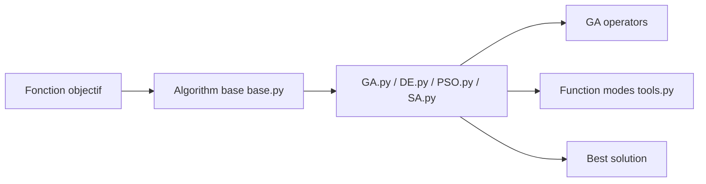

# guofei9987/scikit-opt

> Python library for swarm-intelligence optimization: genetic, PSO, annealing, ant colony, etc.

## The problem
Optimizing a non-convex function or a TSP without writing the metaheuristics yourself.

## What it actually does
Provides GA, DE, PSO, SA, ACA, immune algorithm and AFSA, with equality and inequality constraints. Replaceable GA operators (UDF), resuming a run (`run(10)` then `run(20)`) and four acceleration modes (vectorization, threads, processes, cache). GPU is announced as under development.

## How it is wired


## Trying it
```bash
pip install scikit-opt
```
```python
from sko.GA import GA
ga = GA(func=schaffer, n_dim=2, size_pop=50, max_iter=800, prob_mut=0.001, lb=[-1, -1], ub=[1, 1], precision=1e-7)
best_x, best_y = ga.run()
```

## Cost and gotchas
Free. Last push in March 2026. Metaheuristics offer no guarantee of a global optimum.

## What it is not
Not an exact solver (linear programming, etc.) nor a dedicated hyperparameter optimization tool.

## Alternatives
No alternative named in the README.

## For you
Watch: handy for heuristic or educational optimization, but other tools cover hyperparameter tuning better.
