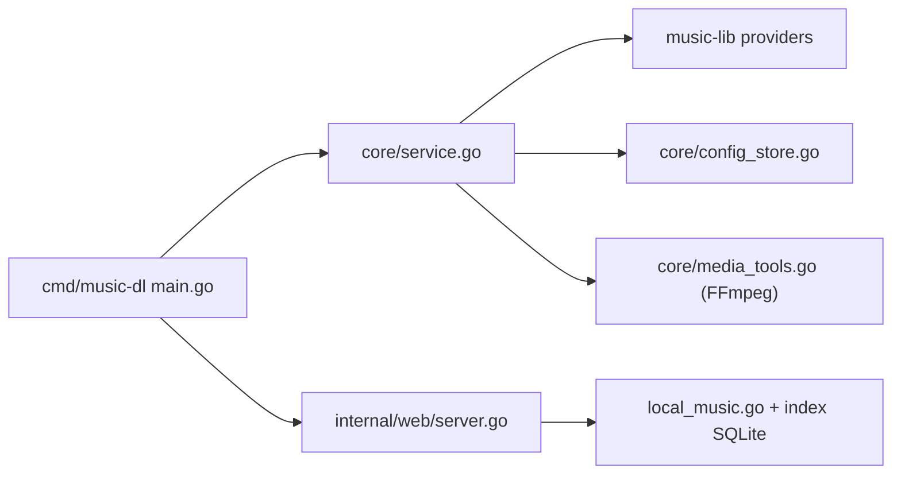

# guohuiyuan/go-music-dl

> Music search and download tool for multiple Chinese platforms, with a web interface, terminal or native app.

## The problem
Searching, listening to and downloading music spread across many services (NetEase, QQ, Kugou, Bilibili...) from a single entry point.

## What it actually does
A Go binary with CLI/TUI (Cobra, Bubble Tea) and a Gin web server. A `core` layer calls the external `music-lib` library for each provider. It handles local playlists (SQLite), cookies and QR code login, an indexed local library, source replacement, word-by-word lyrics. Hosts: Rust (Tao/Wry) for desktop, Go/Gio for Android and iOS.

## How it is wired


## Trying it
```bash
./music-dl web
./music-dl -k "周杰伦"
docker compose up -d --remove-orphans
```
The README requires creating the `data` folder first (`mkdir -p data && chmod 777 data`).

## Cost and gotchas
Free, but depends on third-party APIs that change: the README admits some sites stop working. FFmpeg optional. Cookies are stored locally. AGPL-3.0 license.

## What it is not
Not a legal service: the README says "for study purposes" and asks to delete downloaded files within 24 hours. Paid content is filtered, but compliance with the platforms remains your responsibility.

## Alternatives
- 0xHJK/music-dl and CharlesPikachu/musicdl: download libraries it draws inspiration from.
- metowolf/Meting: reference for multi-platform aggregation.

## For you
Ignore: no link to data or AI, dependence on fragile Chinese platforms and doubtful legal status of the downloads.
