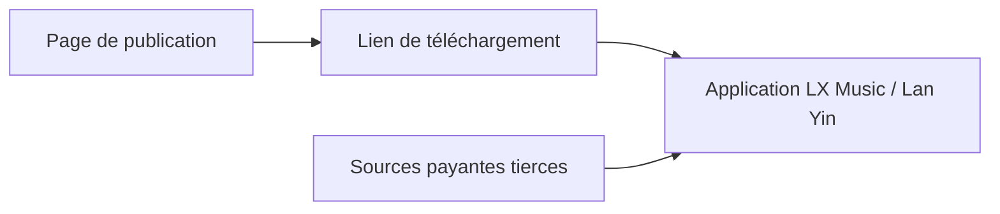

# guoyue2010/lxmusic-

> Publication page for music sources for LX Music and Lan Yin, with paid third-party offers.

## The problem
The LX Music and Lan Yin players need music sources to import.

## What it actually does
Publication repository: download links, list of maintainers, and paid source services sold by third parties (time-limited cards, prices in yuan). README in Chinese; it asks to delete caches within 24 hours and to "support the originals". The content includes advertisements.

## How it is wired
No diagram provided and no code described. Sheet reduced to a usage diagram not documented by the repository.



## Trying it
No command in the README; the paid source uses an import link with a key (`...api/script/lx?key=<carte>`).

```bash
# aucune commande dans le README
```

## Cost and gotchas
Paid third-party sources, unrelated to the project. Possible legal risk around copyrighted music (nothing in the README settles it).

## What it is not
Not software: a distribution and sales page.

## Alternatives
No alternative named in the README.

## For you
Ignore: commercial content, legally ambiguous, unrelated to data/AI/MLOps.
