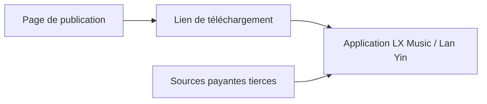

# guoyue2010/lxmusic-

> Page de publication de sources musicales pour LX Music et Lan Yin, avec offres payantes tierces.

## Le problème
Les lecteurs LX Music et Lan Yin ont besoin de sources de musique à importer.

## Ce que ça fait vraiment
Dépôt de publication : liens de téléchargement, liste des mainteneurs, et services de sources payants vendus par des tiers (cartes à durée, prix en yuans). README en chinois ; il demande de supprimer les caches sous 24 h et de « soutenir les originaux ». Le contenu inclut des publicités.

## Comment c'est branché
Pas de diagramme fourni ni de code décrit. Fiche réduite à un schéma d'usage non documenté par le dépôt.



## Essayer
Aucune commande dans le README ; la source payante utilise un lien d'import avec clé (`...api/script/lx?key=<carte>`).

```bash
# aucune commande dans le README
```

## Coût et pièges
Sources payantes de tiers, sans lien avec le projet. Risque juridique possible autour de la musique protégée (aucun élément du README ne le tranche).

## Ce que ce n'est pas
Pas un logiciel : une page de distribution et de vente.

## Alternatives
Aucune alternative nommée dans le README.

## Pour toi
À ignorer : contenu commercial, juridiquement ambigu, sans lien avec data/IA/MLOps.

