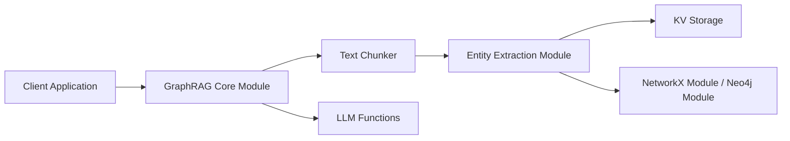

# gusye1234/nano-graphrag

> A short (about 1,100 lines) GraphRAG implementation, readable and hackable, for RAG engineers.

## The problem
The official GraphRAG implementation is hard to read and adapt, which slows down experimentation.

## What it actually does
`GraphRAG` splits the text, extracts entities and relations with an LLM, computes the graph's communities, produces community reports, then answers in global, local or naive mode. The components are interchangeable: LLM (OpenAI, Bedrock, DeepSeek, Ollama), embeddings, vector store (`nano-vectordb`, `hnswlib`, Milvus Lite, Faiss), graph (`networkx` or Neo4j). Insertion is incremental (MD5 hashing of contents) and each method has an async counterpart.

## How it is wired


## Trying it
```bash
pip install nano-graphrag
export OPENAI_API_KEY="sk-..."
curl https://raw.githubusercontent.com/gusye1234/nano-graphrag/main/tests/mock_data.txt > ./book.txt
```
Then, `GraphRAG(working_dir="./dickens")`, `insert(...)` and `query(...)` in Python.

## Cost and gotchas
Two models are required: a "big" one (`gpt-4o` by default) and a "small" one (`gpt-4o-mini`). At each insertion, communities are recomputed and reports regenerated, with the corresponding LLM cost. Without a key, the README points to an Ollama and Transformers example.

## What it is not
It is not a faithful copy: the "covariates" feature is not implemented and global search only uses the 512 most important communities by default. The README announces benchmarks without giving the figures.

## Alternatives
- memobase: for long-term multi-user memory, cited by the README.
- LightRAG: a project that reuses nano-graphrag, with more features.
- fast-graphrag: a RAG that adapts to data and queries, cited in the same way.

## For you
Adopt to understand or prototype a graph RAG: the code is short and the building blocks are replaceable; for a multi-user service, look at the alternatives instead.
