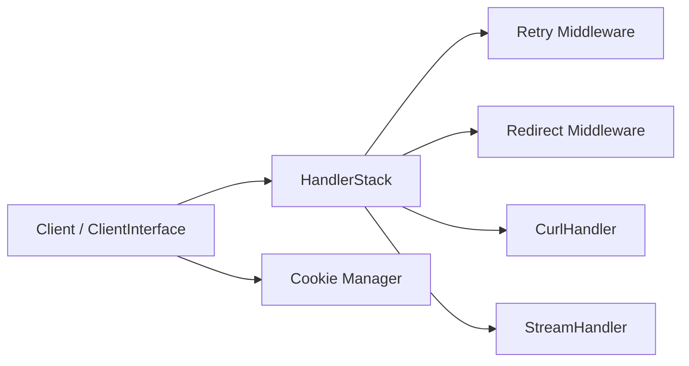

# guzzle/guzzle

> PHP HTTP client for sending synchronous or asynchronous requests, for PHP developers.

## The problem
Calling web APIs in PHP with cURL or native streams is verbose and tied to the chosen transport.

## What it actually does
A single interface to build requests (query, POST, JSON, cookies, streamed uploads/downloads), synchronous or asynchronous. Relies on PSR-7 and PSR-18. A middleware system (redirect, retry, body preparation) is composed on a stack of handlers (cURL, PHP streams, multi-cURL).

## How it is wired


## Trying it
```bash
composer require guzzlehttp/guzzle
```
```php
$client = new \GuzzleHttp\Client();
$response = $client->request('GET', 'https://api.example.com/users/123');
echo $response->getStatusCode();
```

## Cost and gotchas
Free, installed via Composer. The 8.3 branch targets PHP >=7.4,<8.7; 6.5 is end of life.

## What it is not
Not a data/AI tool: it is a PHP building block. Support goes through Stack Overflow/Slack, not GitHub issues (reserved for bugs and features).

## Alternatives
Any PSR-18 compatible client (the README claims interoperability), without naming any.

## For you
Ignore: excellent HTTP client, but only useful if you write PHP, outside the data / AI / MLOps scope.
