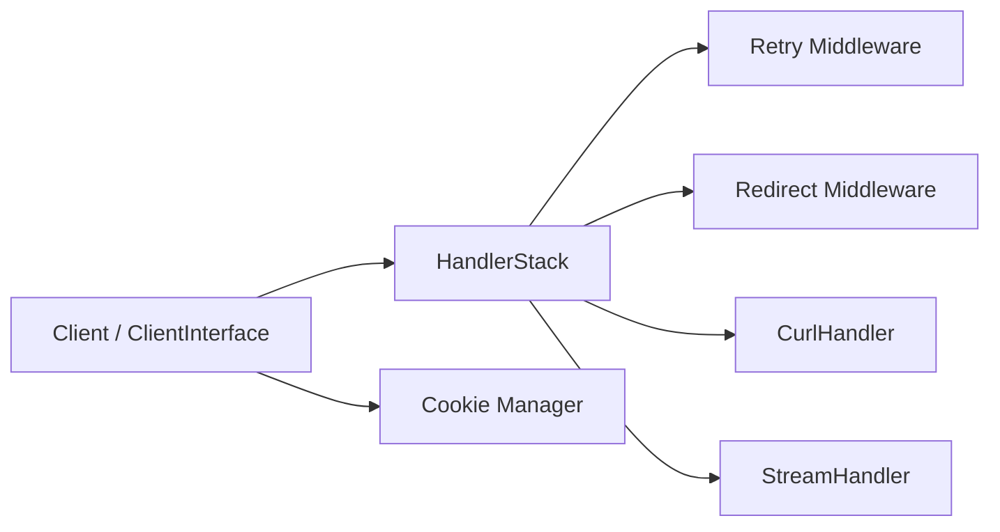

# guzzle/guzzle

> Client HTTP PHP pour envoyer des requêtes synchrones ou asynchrones, pour développeurs PHP.

## Le problème
Appeler des API web en PHP avec cURL ou les flux natifs est verbeux et lié au transport choisi.

## Ce que ça fait vraiment
Une interface unique pour construire des requêtes (query, POST, JSON, cookies, uploads/downloads en flux), en synchrone ou asynchrone. S'appuie sur PSR-7 et PSR-18. Un système de middleware (redirection, retry, préparation du corps) se compose sur une pile de handlers (cURL, flux PHP, multi-cURL).

## Comment c'est branché


## Essayer
```bash
composer require guzzlehttp/guzzle
```
```php
$client = new \GuzzleHttp\Client();
$response = $client->request('GET', 'https://api.example.com/users/123');
echo $response->getStatusCode();
```

## Coût et pièges
Gratuit, installation via Composer. La branche 8.3 vise PHP >=7.4,<8.7 ; la 6.5 est en fin de vie.

## Ce que ce n'est pas
Pas un outil pour data/IA : c'est une brique PHP. Le support passe par Stack Overflow/Slack, pas par les issues GitHub (réservées aux bugs et fonctionnalités).

## Alternatives
Tout client compatible PSR-18 (le README en revendique l'interopérabilité), sans en nommer.

## Pour toi
Ignorer : excellent client HTTP, mais il ne sert que si tu écris du PHP, hors du périmètre data / IA / MLOps.

