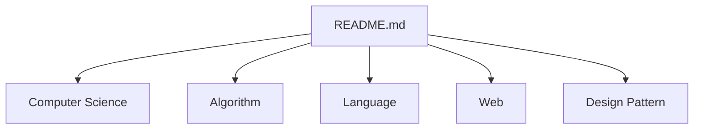

# gyoogle/tech-interview-for-developer

> Korean-language encyclopedia of computer science notions to prepare junior developer technical interviews.

## The problem
A junior developer has to review architecture, data structures, networking, OS and algorithms all at once before an interview.

## What it actually does
A table of contents of Markdown notes, in Korean: Computer Science (architecture, data structures, databases, networking, OS, software engineering), algorithms, design patterns, interview, languages (C, C++, Java, JavaScript, Python), web (Spring, Vue, React), Linux, new technologies (AI, big data). A website accompanies the repository.

## How it is wired


## Trying it
```bash
# Aucune commande : lire les notes depuis le README ou le site web.
```

## Cost and gotchas
Free. Content in Korean. Last push on 2025-06-04, more than a year ago.

## What it is not
Not an interactive course nor a bank of solved exercises. The AI and big data parts are minimal (TensorFlow linear regression, DBSCAN).

## Alternatives
No alternative named in the README (it points to tech-refrigerator for a few Java notes).

## For you
Ignore: Korean-language resource, focused on developer interviews, with very little AI or MLOps, and not updated for more than a year.
