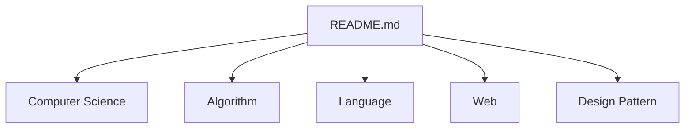

# gyoogle/tech-interview-for-developer

> Encyclopédie en coréen de notions d'informatique pour préparer les entretiens techniques de développeur débutant.

## Le problème
Un développeur junior doit réviser en vrac architecture, structures de données, réseau, OS et algorithmes avant un entretien.

## Ce que ça fait vraiment
Un sommaire de notes Markdown, en coréen : Computer Science (architecture, structures de données, base de données, réseau, OS, génie logiciel), algorithmes, design patterns, entretien, langages (C, C++, Java, JavaScript, Python), web (Spring, Vue, React), Linux, nouvelles technos (IA, big data). Un site web accompagne le dépôt.

## Comment c'est branché


## Essayer
```bash
# Aucune commande : lire les notes depuis le README ou le site web.
```

## Coût et pièges
Gratuit. Contenu en coréen. Dernier push le 2025-06-04, soit plus d'un an.

## Ce que ce n'est pas
Pas un cours interactif ni une base d'exercices corrigés. Les parties IA et big data sont minimes (régression linéaire TensorFlow, DBSCAN).

## Alternatives
Aucune alternative nommée dans le README (il pointe vers tech-refrigerator pour quelques notes Java).

## Pour toi
Ignorer : ressource en coréen, centrée sur les entretiens développeur, avec très peu d'IA ou de MLOps, et plus mise à jour depuis plus d'un an.

