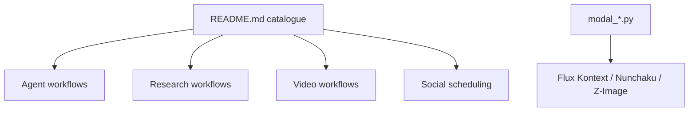

# gyoridavid/ai_agents_az

> n8n workflow templates, one per episode, for AI agents, videos and social networks, for creators.

## The problem
Building n8n workflows for agents and video or image generation from scratch takes time.

## What it actually does
A collection of importable n8n templates, one per episode of a video series (42 episodes listed, season 1 incomplete): prescription agent, daily watch, deep research, lead generation, YouTube and TikTok videos, Postiz publishing. A few Python examples for Modal (Flux Kontext, Wan ComfyUI, Qwen Image, Z-Image). Three side servers cited: no-code tools, MCP/REST for short videos, narrated stories.

## How it is wired

The links between workflows are not described.

## Trying it
No command documented. Browse the README, open an episode's folder (`episode_19`, `episode_24`, `episode_40`) and import the template into n8n.

## Cost and gotchas
You need an n8n instance and, depending on the episode, keys for paid services (video generation, voice, images). Several examples run on Modal or Fal.ai.

## What it is not
Not an application nor a library: workflow files. No license declared: reuse without explicit rights. Many episodes aim at content monetization, not engineering.

## Alternatives
No alternative named in the README.

## For you
Worth watching: a goldmine of n8n automation ideas, but mostly oriented toward content creation; to browse occasionally, not to adopt.
