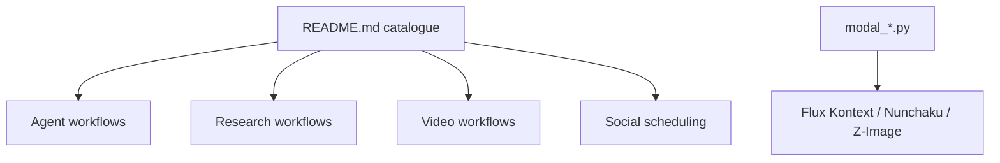

# gyoridavid/ai_agents_az

> Modèles de workflows n8n par épisode pour agents IA, vidéos et réseaux sociaux, pour créateurs.

## Le problème
Monter des workflows n8n d'agents et de génération de vidéo ou d'images à partir de zéro prend du temps.

## Ce que ça fait vraiment
Une collection de templates n8n importables, un par épisode d'une série vidéo (42 épisodes recensés, saison 1 incomplète) : agent d'ordonnances, veille quotidienne, recherche approfondie, génération de leads, vidéos YouTube et TikTok, publication Postiz. Quelques exemples Python pour Modal (Flux Kontext, Wan ComfyUI, Qwen Image, Z-Image). Trois serveurs annexes cités : outils sans code, MCP/REST de vidéos courtes, histoires narrées.

## Comment c'est branché

Les liens entre workflows ne sont pas décrits.

## Essayer
Aucune commande documentée. Parcourir le README, ouvrir le dossier d'un épisode (`episode_19`, `episode_24`, `episode_40`) et importer le template dans n8n.

## Coût et pièges
Il faut une instance n8n et, selon l'épisode, des clés de services payants (génération vidéo, voix, images). Plusieurs exemples tournent sur Modal ou Fal.ai.

## Ce que ce n'est pas
Pas une application ni une bibliothèque : des fichiers de workflows. Aucune licence déclarée : réutilisation sans droit explicite. Beaucoup d'épisodes visent la monétisation de contenu, pas l'ingénierie.

## Alternatives
Aucune alternative nommée dans le README.

## Pour toi
À surveiller : une mine d'idées d'automatisation n8n, mais surtout orientée création de contenu ; à parcourir ponctuellement, pas à adopter.

