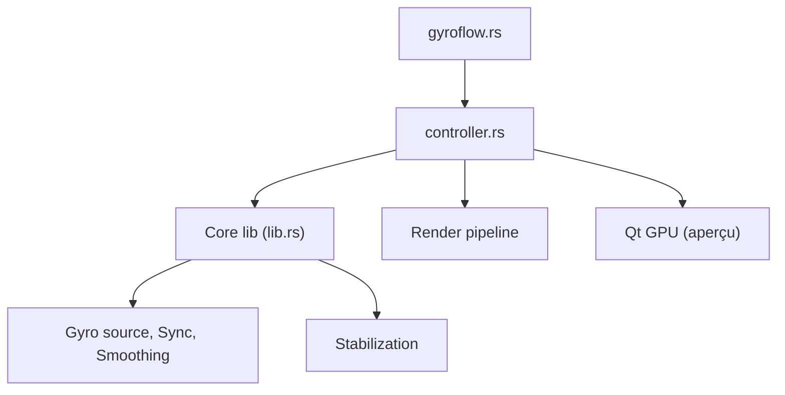

# gyroflow/gyroflow

> An application that stabilises video using the camera's gyroscope data.

## The problem
Software stabilisation without a sensor degrades the image; yet cameras do record their own motion.

## What it actually does
Reads gyroscope data from GoPro, Sony, Insta360 or an external recorder, synchronises it with the video, smooths the orientation and applies lens correction and adaptive zoom. GPU-accelerated rendering, plugins for video editors, written in Rust with a QML interface.

## How it is wired


## Trying it
```bash
brew install gyroflow
cargo install --force just
just install-deps
just run
```

## Cost and gotchas
Free. A GPU and up-to-date graphics drivers are recommended. The binary links mdk-sdk, which is proprietary: GPLv3 license with an additional permission. Heavy build on every platform.

## What it is not
Not a full video editor. Only stabilises well if motion data exists.

## Alternatives
No alternative named in the README.

## For you
Ignore: consumer video processing, unrelated to your data / AI / MLOps work.
